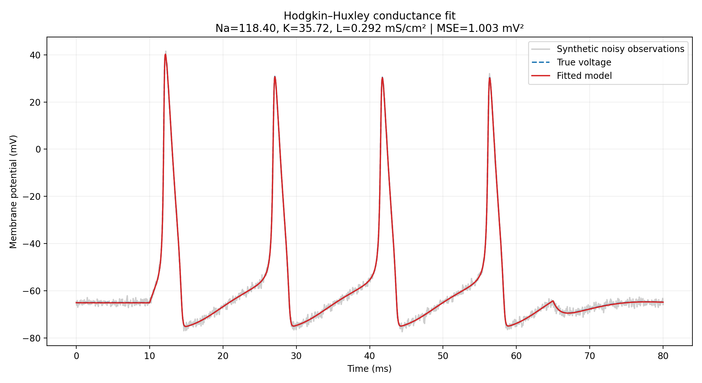
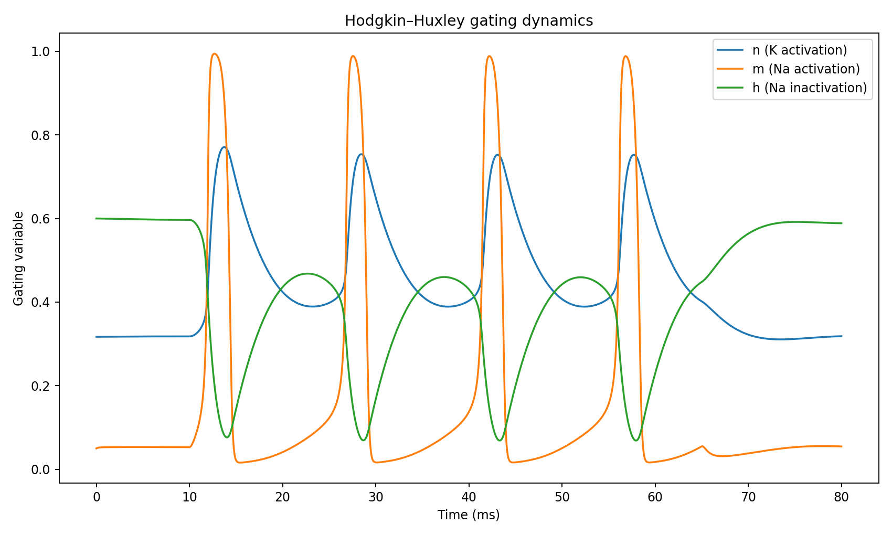

# Hodgkin–Huxley Neuron: Ion-Channel Parameter Estimation

This mini-project investigates an **inverse problem** in computational neuroscience: recovering the maximum sodium, potassium and leak conductances of a Hodgkin–Huxley (HH) neuron from a noisy membrane-voltage recording. It combines a system of nonlinear ordinary differential equations with numerical integration, synthetic data generation and bounded global optimisation.

The data in this repository are **synthetic**; no experimental recordings are used. The project was developed as a numerical modelling and parameter-estimation exercise.

## Mathematical model

The four state variables are membrane voltage $V$, potassium activation $n$, sodium activation $m$ and sodium inactivation $h$. Membrane voltage satisfies:

```math
C_m\frac{dV}{dt} = I_{\mathrm{inj}}(t) - g_{Na}m^3h(V-E_{Na}) - g_K n^4(V-E_K) - g_L(V-E_L).
```

Each gating variable $x \in \{n,m,h\}$ obeys:

```math
\frac{dx}{dt}=\alpha_x(V)(1-x)-\beta_x(V)x.
```

Here $C_m$ is membrane capacitance; $E_{Na}$, $E_K$ and $E_L$ are reversal potentials; and $\alpha_x(V)$ and $\beta_x(V)$ are voltage-dependent transition rates. The three conductances $g_{Na}$, $g_K$ and $g_L$ are the **unknown parameters** to be fitted.

The code uses standard HH gating-rate functions and evaluates their removable singularities numerically safely using `numpy.expm1` and analytic limits.

### Simulation settings

| Setting | Value |
| --- | --- |
| Reference conductances $(g_{Na}, g_K, g_L)$ | $(120, 36, 0.3)$ mS/cm² |
| Membrane capacitance $C_m$ | 1 µF/cm² |
| Reversal potentials $(E_{Na}, E_K, E_L)$ | $(50, -77, -54.387)$ mV |
| Initial state $(V,n,m,h)$ | $(-65, 0.317, 0.05, 0.6)$ |
| Input current | 10 µA/cm² from 10 to 65 ms; zero otherwise |
| Simulation interval | 0–80 ms, sampled at 1,600 time points |
| Synthetic measurement noise | Independent Gaussian, mean 0, standard deviation 1 mV |
| Random seed | 42 |
| ODE solver | SciPy `solve_ivp`, BDF (`max_step=0.5` ms) |

## Parameter-estimation approach

1. **Forward model:** Solve the four HH ODEs with known conductances to obtain a reference voltage trace.
2. **Synthetic observation:** Add Gaussian noise to produce a measured-like voltage recording.
3. **Inverse model:** For each candidate conductance triplet, integrate the same ODEs and compare the predicted voltage to the **noisy** observations.
4. **Optimisation:** Use `scipy.optimize.differential_evolution` to minimise the voltage mean squared error (MSE) within fixed bounds.
5. **Validation:** Plot the noisy data, reference signal and fitted model together, and report the recovered conductances and MSE.

The objective function is:

```math
\mathrm{MSE}(\boldsymbol{g}) = \frac{1}{N}\sum_{i=1}^{N}\left[V_{\mathrm{model}}(t_i;\boldsymbol{g})-V_{\mathrm{noisy}}(t_i)\right]^2,
```

where $\boldsymbol{g}=(g_{Na},g_K,g_L)$. The parameter bounds, in mS/cm², are:

| Conductance | Lower | Upper |
| --- | ---: | ---: |
| Sodium $g_{Na}$ | 50 | 150 |
| Potassium $g_K$ | 10 | 50 |
| Leak $g_L$ | 0 | 1 |

The optimiser uses a fixed random seed (`42`), `maxiter=30`, `popsize=10`, and a final local polishing step. It reports whether the convergence criterion was met; a useful best-fit result does **not** necessarily imply formal optimiser convergence.

## Project files

| File | Purpose |
| --- | --- |
| `Vm_generator.py` | Defines the HH model and pulse protocol; generates `Generated_Vm.csv` and `HH_synthetic_data.png` |
| `Optimizer.py` | Loads noisy observations, fits the three conductances and saves `recovered_g_params.txt` |
| `Plotter.py` | Re-simulates the fitted model and saves `HH_parameter_fit.png` |
| `HH_Parameter_Estimation.ipynb` | Self-contained, annotated walkthrough of the mathematical model and inverse problem |
| `Generated_Vm.csv` | Reproducible example dataset (`Time_step`, `True_Vm`, `Noisy_Vm`) |
| `recovered_g_params.txt` | Example estimated conductances from the included dataset |
| `HH_synthetic_data.png` | Reference and noisy recordings |
| `HH_parameter_fit.png` | Comparison of synthetic observations, reference voltage and fitted model |
| `HH_gating_dynamics.png` | Gating-variable time series (also embedded in the notebook) |
| `requirements.txt` | Python package dependencies |

## Installation

Use a separate virtual environment to avoid conflicts with other scientific or neuroscience packages:

```bash
python -m venv .venv
source .venv/bin/activate  # Linux/macOS
pip install -r requirements.txt
```

On Windows PowerShell, activate the environment with `.venv\Scripts\Activate.ps1` instead of `source .venv/bin/activate`.

**Dependencies:** NumPy, SciPy, pandas, Matplotlib and Jupyter Notebook (for the `.ipynb` file). **JAX, MOOSE, TensorFlow and scikit-learn are not required.**

## Usage

Run the scripts in this order from the `HH_param_estimation` folder:

```bash
python Vm_generator.py
python Optimizer.py
python Plotter.py
```

- `Vm_generator.py` recreates the CSV using a fixed random seed and displays/saves the reference plot.
- `Optimizer.py` estimates $g_{Na}$, $g_K$ and $g_L$ and writes the fitted values to the text file. A single optimisation run may take some time because it solves the HH system repeatedly.
- `Plotter.py` plots the three voltage traces and saves the comparison figure.

For the notebook walkthrough:

```bash
jupyter notebook HH_Parameter_Estimation.ipynb
```

Run the notebook cells from top to bottom. Its numerical setup and random seed match the standalone scripts, but the notebook is self-contained and does not import the other `.py` files.

## Example result



The included `recovered_g_params.txt` contains the conductances estimated from the accompanying synthetic dataset. A representative run using the included settings gives:

| Conductance (mS/cm²) | Ground truth | Estimated |
| --- | ---: | ---: |
| Sodium $g_{Na}$ | 120.0 | 118.4006 |
| Potassium $g_K$ | 36.0 | 35.7212 |
| Leak $g_L$ | 0.3000 | 0.2921 |

The fitted voltage MSE is approximately **1.003 mV²**. The 30-iteration optimisation budget was reached before the differential-evolution convergence test passed (`result.success = False`), despite the close fit; increasing the iteration budget may improve convergence. Numerical results can vary slightly across SciPy versions. **A low voltage fitting error is not proof of unique parameter identification.**

The notebook also visualises the simulated gating variables:



## What this exercise covers

- Modelling membrane and ion-channel dynamics with four coupled nonlinear ODEs.
- Integrating the HH equations numerically with a stiff BDF solver.
- Creating and handling reproducible noisy synthetic time-series data.
- Formulating an inverse problem through a voltage-based MSE objective.
- Fitting biophysical conductances using bounded differential evolution.
- Checking numerical solver status, comparing simulated and fitted traces, and reporting model limitations.

## Limitations

This is an educational **synthetic-data** experiment. The stimulus, capacitance, reversal potentials, initial gating states and observation-noise model are assumed known. Only three conductances are fitted, with one fixed current protocol; fitting real electrophysiological recordings would require additional treatment of measurement noise, initial conditions, stimulation uncertainty, parameter identifiability and model mismatch.
