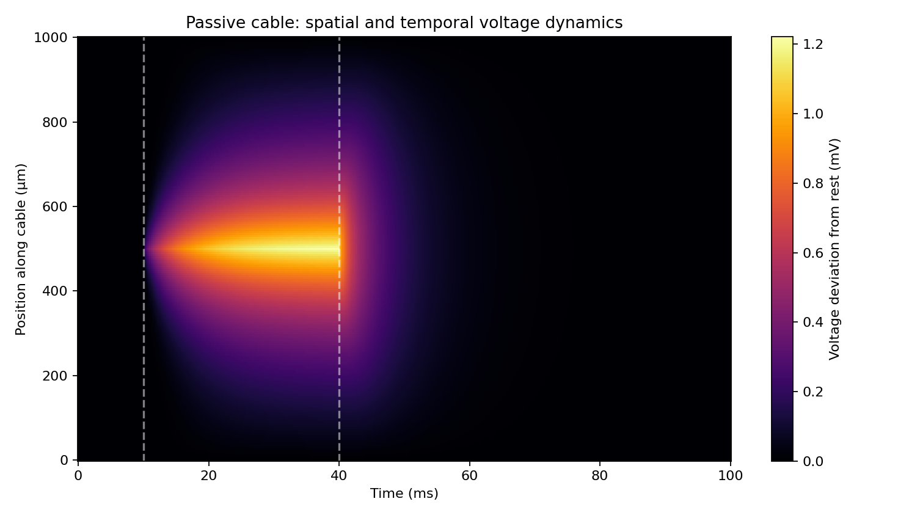
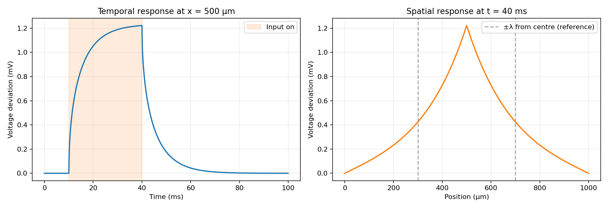
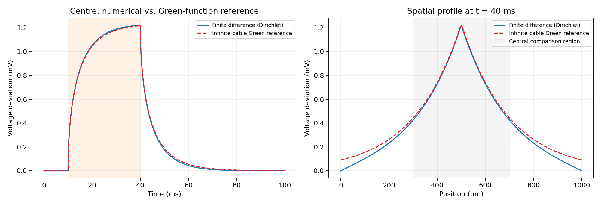

# Passive Dendrite: Numerical Solution of the Cable Equation

This independent numerical-methods project investigates how an idealised **passive dendrite** responds to a brief, localised input. It solves a one-dimensional reaction–diffusion PDE using **finite differences**, the **Method of Lines**, a **sparse matrix operator**, and SciPy's ODE solvers. The finite-domain numerical result is also compared with a **Green-function solution on an infinite cable**.

The model describes passive voltage spread and leakage, not active action-potential generation.

## Mathematical model

For voltage deviation from rest $V(x,t)$ (mV), the passive cable equation is

```math
\tau\frac{\partial V}{\partial t}=\lambda^2\frac{\partial^2 V}{\partial x^2}-V+I(x,t).
```

Here $\tau$ is the membrane time constant (ms), $\lambda$ the cable space constant (µm), and $I(x,t)$ an **effective voltage-equivalent forcing (mV)** rather than a calibrated injection current in µA/cm². The effective diffusion coefficient is $D=\lambda^2/\tau$ (µm²/ms).

The **finite computational cable** uses fixed-voltage (Dirichlet) boundary conditions:

```math
V(0,t)=V(L,t)=0,\qquad V(x,0)=0.
```

This is distinct from sealed-end (Neumann) boundaries. The input is applied at the centre node from 10 to 40 ms. Spatial discretisation uses

```math
\left.\frac{\partial^2 V}{\partial x^2}\right|_{x_i}
\approx\frac{V_{i-1}-2V_i+V_{i+1}}{\Delta x^2},\qquad
\Delta x=\frac{L}{N-1}.
```

This produces a sparse tridiagonal system of ODEs. Integration is split at the input transitions so the solver resolves the discontinuous forcing. **BDF**, supplied with the sparse Jacobian, is the default; **RK45** is available for experimentation.

### Infinite-cable Green-function reference

For the *infinite* cable, the fundamental solution of the diffusion-plus-leak equation is

```math
G(x-y,u)=\frac{e^{-u/\tau}}{\sqrt{4\pi Du}}
\exp\left[-\frac{(x-y)^2}{4Du}\right],\qquad u>0.
```

To match a stimulated numerical cell, the analytical reference assumes a one-cell-wide uniform spatial input switched on between the same two pulse times. Its spatial convolution uses `scipy.special.erf`, while its time integral uses Gauss–Legendre quadrature.

**Important:** The finite numerical cable and infinite-cable reference have **different boundary conditions**. Their close agreement near the centre is a useful consistency check, not proof that the two global solutions are identical. Differences near the ends are expected.

## Libraries and techniques

- **NumPy:** Spatial and time grids, array operations, quadrature, saved arrays.
- **SciPy (`sparse`, `integrate`, `special`):** Tridiagonal operator, BDF/RK45, and Green-function evaluation.
- **Matplotlib:** Heatmaps, voltage profiles and numerical/analytical comparisons.
- **JupyterLab:** Explanatory notebook with equations and executable analysis.

JAX, MOOSE, TensorFlow and specialised neuroscience frameworks are **not required**.

## Repository files

```text
Passive_Dendrite_Model/
├── main.py                         # Solver, Green-function reference, CLI
├── Passive_Dendrite_Model.ipynb    # Annotated numerical-methods notebook
├── README.md
├── requirements.txt
├── .gitignore
├── tests/
│   └── test_model.py               # Numerical, boundary and input checks
├── figures/
│   ├── voltage_heatmap.png
│   ├── temporal_spatial_profiles.png
│   └── green_function_comparison.png
└── data/
    ├── simulation_results.npz      # Space/time grids and voltage arrays
    └── validation_metrics.json     # Settings and comparison statistics
```

## Installation and usage

Create an isolated environment, preferably from the project folder:

```bash
python -m venv .venv
source .venv/bin/activate          # Linux/macOS
# Windows PowerShell: .venv\Scripts\Activate.ps1
python -m pip install -r requirements.txt
```

Regenerate all figures and the example data:

```bash
python main.py
```

On a desktop, add `--show` to open the figures interactively. Explore the parameter options:

```bash
python main.py --help
python main.py --tau 12 --lambda-um 250 --points 301
python main.py --method RK45
```

Launch the notebook **from the same directory** so `from main import ...` resolves:

```bash
jupyter lab Passive_Dendrite_Model.ipynb
```

Run the checks:

```bash
python -m unittest discover -s tests -v
```

### Default parameters

| Parameter | Default | Meaning |
| --- | --- | --- |
| `length_um` | 1000 µm | Finite cable length |
| `n_points` | 201 | Odd number of spatial nodes including endpoints |
| `dx_um` | 5 µm | Spatial grid spacing |
| `tau_ms` | 10 ms | Membrane time constant |
| `lambda_um` | 200 µm | Cable space constant |
| `input_mV` | 100 mV | Effective local forcing at centre node |
| `pulse_start_ms` | 10 ms | Stimulus onset |
| `pulse_end_ms` | 40 ms | Stimulus offset |
| `duration_ms` | 100 ms | Simulation duration |
| `solver` | BDF | Implicit ODE solver (RK45 optional) |

## Results

**Spatiotemporal voltage response**



**Temporal and spatial profiles**



**Comparison with the infinite-cable Green-function reference**



With the default settings, the peak voltage deviation is approximately **1.22 mV**. The centre-trace RMSE against the infinite-cable reference is approximately **0.008 mV**. Within ± one space constant of the centre, the spatial RMSE at the end of the pulse is approximately **0.013 mV**. Exact settings and values are recorded in `data/validation_metrics.json`.

## Learning outcomes and limitations

The exercise demonstrates finite-difference discretisation of PDEs, sparse linear operators, the Method of Lines, numerical ODE integration with discontinuous forcing, and analytical validation using a Green function.

The cable is homogeneous, passive and unbranched. It does not model active ion channels, dendritic trees or calibrated electrode currents. The endpoint voltage is clamped to rest rather than using sealed ends. Also, a transient response generally does **not** decay by precisely $1/e$ after one $\tau$ at a fixed point, nor after one $\lambda$ along the cable: diffusion, leakage, stimulus history and boundary conditions all affect the observed profile.
