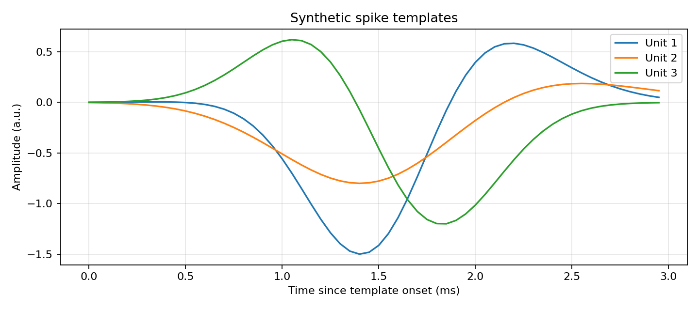
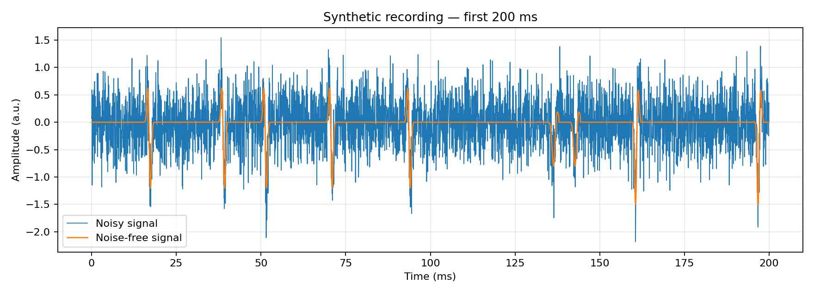
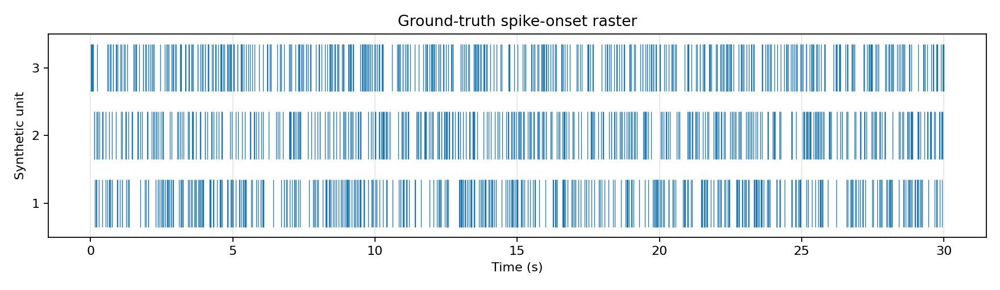

# Synthetic Extracellular Spike-Train Generation

This mini-project generates an **extracellular-like synthetic recording** from three distinct spike waveforms. It was developed as a computational exercise in stochastic signal generation, time-series analysis, and neuronal spike data. The project includes a reproducible Python generator, a notebook explaining the mathematical model, noisy and noise-free recordings, and the ground-truth times of inserted spikes.

**Scope:** This is a simplified signal-generation experiment, not a biophysical extracellular neuron simulation or a completed spike-sorting algorithm. The known spike times provide a starting point for future detection and classification experiments.

## Mathematical model

Each unit has a different 3 ms waveform template, constructed from combinations of Gaussian functions. For each unit, the number of inserted events is Poisson-distributed:

```math
N_u \sim \mathrm{Poisson}(\lambda T)
```

Here, `u` identifies one of three units, `lambda` is its average firing rate, and `T` is the recording duration. Given each event count, onset samples are drawn uniformly **without replacement**. This approximates independent homogeneous Poisson spike trains on the sampling grid; it is not a continuous-time Poisson process with unrestricted coincident events.

The noise-free recording is the sum of the shifted templates, including overlapping events:

```math
s[k] = \sum_{u=1}^{3}\sum_{j=1}^{N_u}h_u[k-k_{u,j}]
```

The observed recording includes independent additive Gaussian noise:

```math
y[k]=s[k]+\eta[k],\qquad \eta[k]\sim \mathcal{N}(0,\sigma^2)
```

All waveform amplitudes are in **arbitrary units** rather than calibrated millivolts.

### Default simulation settings

| Parameter | Value | Meaning |
| --- | --- | --- |
| Sampling rate | `20,000 Hz` | 20,000 samples per second |
| Recording length | `30 s` | 600,000 samples |
| Spike-template width | `3 ms` | 60 samples per waveform |
| Synthetic units | `3` | Three distinct waveform shapes |
| Mean firing rate | `15 Hz` per unit | Expected event count is 450 per unit over 30 s |
| Noise standard deviation | `0.4` | Additive Gaussian noise, arbitrary units |
| Random seed | `42` | Reproducible event times and noise |

## Output examples

### Waveform templates



### Short recording preview

The first 200 ms is plotted so individual waveforms and noise are visible. The CSV contains the complete 30-second recording.



### Known spike onsets



With the included seed (`42`), the recording contains **468**, **444**, and **500** inserted events for units 1, 2, and 3, respectively. The realised firing rates are therefore not exactly 15 Hz in a finite sample.

## Files

```text
Synthetic_Spike_Generation/
├── generator.py                     # Generate data, annotations, and plots
├── Synthetic_Spike_Generation.ipynb  # Mathematical explanations and exploratory analysis
├── synthetic_spikes.csv             # Full synthetic recording (600,000 samples)
├── ground_truth_spikes.csv          # Known unit IDs and template onset times
├── figures/
│   ├── spike_templates.png
│   ├── signal_preview.png
│   └── ground_truth_raster.png
├── requirements.txt
├── .gitignore
└── README.md
```

### CSV columns

**`synthetic_spikes.csv`**

| Column | Description |
| --- | --- |
| `time` | Time in **seconds** |
| `v_gen` | Noise-free, superimposed waveform signal |
| `v_noisy` | Noisy observed signal |

**`ground_truth_spikes.csv`**

| Column | Description |
| --- | --- |
| `unit_id` | Source waveform (1, 2, or 3) |
| `start_sample` | Index where a template was inserted, zero-based |
| `start_time_s` | Corresponding **onset** time in seconds |

The annotations indicate **template onset**, not spike-peak time. Different units' templates may overlap in the recording.

## Installation

Python 3.10 or later is recommended. To avoid changing an existing neuroscience or JAX environment, use a dedicated environment:

```bash
conda create -n synthetic_spikes python=3.12 -y
conda activate synthetic_spikes
python -m pip install -r requirements.txt
```

Dependencies: **NumPy, pandas, Matplotlib**, and **JupyterLab** for the notebook. This project does **not** need SciPy, JAX, MOOSE, or TensorFlow.

## Running the project

Run from this directory:

```bash
python generator.py
```

The script produces both CSV files, saves three figures, prints event counts, and opens the plots. For environments without a graphical desktop:

```bash
python generator.py --no-show
```

To change selected simulation settings:

```bash
python generator.py --duration 10 --rate 20 --noise-std 0.25 --seed 123 --no-show
```

Key options are `--duration` (seconds), `--sample-rate` (Hz), `--rate` (mean events/s for each unit), `--noise-std`, `--seed`, `--preview-ms`, `--output-dir`, and `--no-show`. The template width is currently fixed at 3 ms in the code.

To open the exploratory notebook:

```bash
jupyter lab Synthetic_Spike_Generation.ipynb
```

**Notebook reproducibility note:** The notebook checks the included **default** 30-second, 20-kHz, seed-42 dataset against `generator.py`. If you have regenerated the CSV files with custom parameters, restore the defaults (`python generator.py --no-show`) before running the notebook's validation cells.

## What this project demonstrates

- Constructing and combining waveform templates in a discretely sampled signal.
- Generating random spike counts and onsets for multiple units.
- Adding Gaussian noise and controlling reproducibility with random seeds.
- Visualising waveform shapes, short recording windows, and spike-event rasters.
- Recording known spike times for future evaluation of detection or sorting methods.

**Possible extensions:** threshold-based spike detection, waveform alignment, principal component analysis, clustering, and comparisons with the ground-truth labels. These features have **not** been implemented here.
